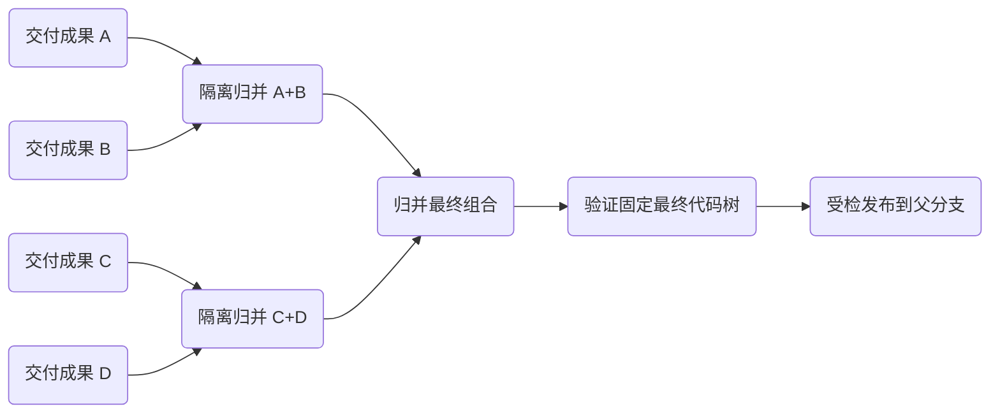

# 归并合并：并行准备，单点落地

本文是 W205 的功能设计方案，面向用户与实现者。用户在 D482 明确选择：每批一个目标分支提交、按需创建专用整合 Worker、允许无已知依赖的就绪组合先交付。**首版代码已实现按目标分支选择的新协议；默认关闭，不改变 Worker 授权或历史协议。**

阅读路线：**产品与理念（本篇）** → [算法与架构](../engineering/merge-convergence-protocol.md) → [异常与迭代](../engineering/merge-convergence-cases.md) → [实施与验证](../engineering/merge-convergence-rollout.md)。默认关闭的旧路径仍见[分支合并](../engineering/merge.md)；首版现状见[实施接缝](../engineering/merge-convergence-implementation.md#首版实现与明确限制)。

A205-1／D512 已要求开发首版：按目标分支选择开启、默认关闭，选择已授权快捷指令验证组合，包含专用整合 Worker。首版接口以[实施接缝](../engineering/merge-convergence-implementation.md)为准，该分支开关要求优先于下文最终统一入口的愿景；下文保留长期产品愿景；动态扩批、阻塞批次内部拆分与更完整的交付摘要不属于首版。代码合入不等于正在运行的 daemon/Host 已更新，部署需用户在安全点重启。

## 结论

归并的单位是 **Worker 已固定的一轮交付成果**，不是 Worker 本身。多个成果在隔离区两两合成，等待期间可以继续归并；形成有界批次后验证最终组合，再一次性进入真实父分支。Worker 的编号、目标、委派关系、会话、源分支和验收各自保留。

对用户而言，仍然只需要「合并」和「验收」；对系统而言，合并拆成「准备成果」与「发布成果」。不要让用户管理归并树、选配对或创建中间分支。

## 为什么当前队列会堵

源码审查发现以下串行路径，尚未做真实负载性能测量：

- `project/merge-queue.js` 在源分支与父分支历史分叉时唤醒原 Worker，**即使没有文本冲突也进入源侧修复**；修复期间保留父逻辑执行位。
- `workspaces/merge.js` 的 Squash 要求父基线是源提交祖先，不能直接把互不冲突的分叉成果合成后落地。
- `Workspaces.exclusive` 还串行管理项目 Git 变更；它与跨 Agent 的父逻辑执行位是两个不同瓶颈。

因此先到的修复会挡住后到的落地。只增加开发 Agent 并发、只批量点击合并、只把队列画成树，都不会消除这条等待链。

## 借鉴归并排序，不照搬排序算法

图中的中间节点是技术记录，不是把原 Worker 重挂到新父节点。A+B 与 C+D 可以同时准备；真实父分支仍只有一个受检写入者。

平衡树通常有 `n−1` 次组合、约 `ceil(log₂ n)` 层，但代码合并不是可交换、可结合的排序比较。冲突修复、跨模块适配与测试仍有成本；每层处理的数据也会增长。**不得承诺总耗时 O(log n)、必然无堵车或固定加速倍数。**

实际收益来自减少逐 Worker 唤醒、并行处理不相关组合、摊薄最终验证与发布成本。若成果长期彼此冲突，或输入吞吐超过硬件、模型与测试容量，系统仍会积压。

## 产品原则

1. **身份不合并。** 不修改源 Worker 的 `parent_id`、编号、目标或源 ref，不让某个源分支变成其他 Worker 的成果仓库。
2. **就绪不等于落地。** 中间组合成功不设置 `integration='merged'`；只有精确目标落地收据核验成功后才结算成员。
3. **main 不替人解冲突。** 冲突、语义适配、测试在私有资源中完成，不占真实父分支写执行位，不留下冲突 index。
4. **源冻结，父少冻结。** 已授权的固定交付继续冻结源侧普通开发；真实父分支只在受检发布时取得写门。验证排程不阻止用户从父分支新建指令。
5. **简单不等于隐瞒。** 常规配对隐藏，异常、费用、待决、最终目标、批次成员和验证证据可查。
6. **最终组合必须验证。** 原 Worker 的测试不证明组合后的代码。无文本冲突也不等于语义兼容。

## 用户看到什么

Worker 卡片保留开发状态与独立交付状态；交付只展示一行：

| 展示 | 含义 |
|---|---|
| 等待归并 | 已固定交付，等待配对、资源或依赖；详情显示真实原因 |
| 归并中 | 正在隔离区合成或整合，不代表正在写 main |
| 验证中 | 最终组合测试进行中，成员不再自动扩张 |
| 等待落地 | 已验证，等待目标安全点；目标变化会回到重新校验 |
| 已合并 · 待验收 | 本轮成果实际进入真实父分支，保留工作区供追加需求 |

「需要决定」「整合失败」「落地待核查」作为显眼异常，不藏在常规进度里。归并树按需展开，不在主 Worker 树增加中间连线或移动源卡片。

项目内增加轻量「交付」读面：`等待 12 · 归并 4 · 验证 1 · 待处理 1`，展示按当前目标分组的批次、原 Worker 链接、最久等待、阻塞原因和最终提交。数字统计完整事实，不从有界图节点猜全量；不显示虚假的队列名次或预计完成时间。

批次详情默认只显示成员、目标、阶段与异常；高级区显示固定基线、组合版本、树、整合调用、测试与收据。整合 Worker 默认折叠在这里，仍可查完整执行记录与用量，不伪装成原 Worker 的开发。

## 操作保持少而明确

- **合并**：提交当前 Worker 的交付意图；系统选择归并方式，不要求用户选择伙伴。持续自动合并、child 锁定和最高自动环节保持原授权边界。
- **撤回本轮交付**：仅在尚未开始真实落地时移除成员，保留代码与历史；不等于取消 Worker 或撤销已合并代码。
- **重试整合**：只针对失败的固定组合，明确可能调用 Agent；已有成功子组合可复用，不重放未知副作用。
- **验收**：仍逐 Worker 或按已有父级安全批量验收处理，包含资源回收；批次不能连带验收彼此独立的用户指令。

前端含义不直观的操作必须带 `data-help`；可能安排 Agent 的操作带 `agent-call` 与 `agentHelp()`，禁用原因由 `.help-host` 承载。纯 Git 配对不是模型调用，不染紫；开启自动流程须说明将来可能启动整合 Agent。

不新增「归并模式／普通模式」「合并到另一个 Worker」「整批验收」常规按钮。只有一项成果时走同一发布流程，不为了凑两项而等待。

## 批次提交与撤销

一批最终成果在 main 上形成一个单父 Squash 提交，标题简短列出来源摘要，正文带不可变交付标识与成员；来源详情由 Lush 收据查阅，不把日志与凭证写进 Git。

多 Worker 可以指向同一个落地提交，但不能据此合并他们的生命周期。成员被整合适配的范围与结果在详情明示，原 Worker 报告不会被偷偷改写。

代价是原生 Git `revert` 以整批为单位。单个 Worker 的贡献可能与别人的适配不可分，首期不提供「独立撤销」保证；由新的修复指令调整当前代码。历史已有版本、接口或数据迁移也不承诺回退安全。

## 排队策略与简洁的边界

默认按持久入队顺序选择相邻成果，优先照顾最久等待；批次之间允许无已知代码依赖的就绪组合越过待决或失败组合。没有依赖记录不证明语义独立，先交付的组合仍必须针对当时真实父基线重新核验。

仅同项目、同真实直接父目标的成果可以组合；不得跨项目、跨父目标或把父与活动后代放进一个平面批次。先收敛子成果，再交付父成果。历史代码依赖严格上游先落地，未知关系保守阻塞。

批次有成员数、形成时长和修复预算上限；达到发布阶段后不因新成果到来无限扩张。待决只影响相关组合，不占住 main；落地副作用未知则必须阻止同一目标继续写入。

## 反例与验收问题

反例：A 与 B 两两互改源分支；把归并成功当成已合并；用文件不重叠证明没有语义冲突；等待凑满二的幂；每层跑全量却不测最终树；重启重放未知落地；整批验收关闭独立指令；不断扩张让最早成果永远不发布。

验收时应问：原 Worker 能否独立继续？一个待决是否仍挡住无依赖交付？用户是否知道成果究竟进了哪个父分支？最终组合是否真的测过？重启能否精确恢复、不重复落地？收益是否来自实际吞吐与等待时间，而不是少画几个卡片？

下一篇：[算法与架构](../engineering/merge-convergence-protocol.md)。
