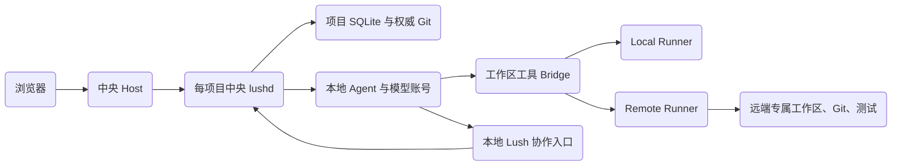

# 本地 Agent 与远端工作区：Runner 改进方案

本文面向后续实施 Agent，说明如何把 Worker 的代码现场与计算移到其他机器，同时把模型通信、账号与项目控制留在本地。来源：W295 与用户追加讨论；状态：**待实施提案，不是现有能力或已冻结的公共 API**。现状核查已复核至固定父提交 `7604bf699c01deb454cf804284850e8fa942fe53`，实施前须复核新基线。

## 1. 已确认方向与范围

用户已确认：Host 集中提供服务；Agent 进程、模型通信与账号登录保留在本地；开发 worktree 与命令执行可以在远端；引入 Runner 抽象。这里“本地”指中央控制机器，不是浏览器所在机器。

首版建议限定可信节点、手动配置、每 Worker 固定节点并跨轮保留工作区；不做活动迁移、跨节点自动故障重跑、多主数据库或控制面高可用。不把整套 Agent 搬到远端，不先单独建设另一套测试卸载系统。传输、后端支持及节点选择策略仍须按第 11 节确认。

## 2. 架构与职责

Host 仍只登记、鉴权和路由；每项目 lushd 决定 Worker 生命周期、消息投递、权限及合并。Runner 是执行基础设施，不是新 Worker、Agent 或另一套项目 daemon，不持有另一份 Worker 数据库。节点即使服务多个项目，也只仲裁本机资源，不决定各项目业务调度。

| 内容 | 所属位置与边界 |
| --- | --- |
| 模型连接、OAuth、私有配置、会话、抢占标记 | 中央机器；不复制到节点 |
| Input / Worker / Run / Message / Notice / 交付事实 | 中央项目 SQLite；沿用现有身份与父子关系 |
| 开发代码、index、未提交内容、测试与构建 | 指定 Runner 的专属工作区；不维护第二份可编辑代码 |
| 权威 refs、接收的 Git 对象、必要集成检出 | 中央；远端仅提交候选成果，不直接推进中央父分支 |
| 临时命令日志与产物 | 节点有界保留，中央按标识接收；传输不完整必须可辨 |

中央可以保留集成检出，不等于给每个远端 Worker 再建一份本地开发 worktree。现有 [Host 边界](../engineering/host-boundary.md)及[工作台设计](workbench.md)仍是现状；远端执行属于新增接缝，不自动扩展为 SSH 配置管理、远端安装或整机运维。

## 3. 传输无关的 Runner 内部接口草案

| 能力 | 必须表达的语义 |
| --- | --- |
| 握手与诊断 | 协议/实现版本、节点身份、OS/架构、工具链、支持的工具与限额；不兼容时启动前拒绝 |
| 工作区准备/检查 | 项目与 Worker 所属、固定基线、分支、实际 HEAD、脏状态、工作区代次；不以目录存在代替身份校验 |
| 文件读取/搜索/编辑/写入 | 相对代码路径、有界文本/二进制/图片传输、版本或内容前置条件；编辑精确匹配，冲突不覆盖 |
| 命令启动/状态/输出/取消 | 执行 ID、argv 或明确的 Shell 脚本、cwd、受限 env、预算、输出游标、退出原因、实际停止确认 |
| Git 对象与产物交换 | 固定提交或产物 ID、大小、摘要、完整性与接收确认；不开放任意宿主路径下载 |
| 安全同步与清理 | 固定旧/新 HEAD、无活动写入和清洁度前置条件；只回收已登记专属资源，失败可续办 |

请求至少绑定中央项目身份、Worker ID、Run ID（控制动作使用独立授权操作 ID）、节点/工作区代次和请求 ID。节点登记不得依赖客户端随意提供的绝对路径；后台已开始的受权操作与后续新请求应分开校验。协议错误码和能力集合复用单一注册来源。

命令启动必须先持久记录再产生副作用；同一请求 ID、相同参数只启动一次，参数不一致拒绝。输出分块带序号并允许重连续读；重复通知可去重，但不能因此承诺任意命令 exactly-once。日志截断、输出缺口、超时、取消与普通非零退出分别表示。

SSH 与 HTTPS 都可承载此协议。SSH 首版可使用用户预置的受控 Runner 经标准输入输出交换结构化帧，禁止把不可信参数插进远端启动字符串；HTTPS 常驻节点须有独立机器认证、加密及撤销机制，不能复用浏览器登录会话。网络监听、认证与安装方案须先确认，不默认开放端口。

## 4. 本地 Agent 的工具与路径边界

- 保留本地模型 Provider，代码 read/edit/write、搜索、图片读取、Shell、Git 均经过统一工作区接口路由到 Runner；不是新增“远端 Provider”。保持工具原有精确性与有界输出，本机文件工具不得偷偷读写同名路径。
- 使用明确的逻辑工作区身份与远端路径；Agent 的本地进程 cwd 只是受控启动目录，不再冒充代码 worktree。启动 JSON/Prompt 区分中央 project/home、代码工作区、工具 cwd 和只读上下文，不能通过篡改 `LUSH_PROJECT` 等既有绑定来伪装远端项目。
- AGENTS.md、项目上下文和受支持的项目资源从正确的远端基线加载，嵌套规则与信任处理不得丢失。设备私有配置仍在本地；不自动执行远端 `.pi` 扩展，也不无提示改变现有 Pi 默认模式语义。
- Lush 协作走本地受限 Bridge。兼容 Shell 中的 `lushc` 时，远端提供固定开发代理，按当前 invocation 身份回到中央；不挂载原始管理 socket，不给无 token 请求用户权限。普通开发权限不扩张；若接入管理代理，沿用[项目管家权限](../engineering/hook-signals-management.md#当前项目管家权限)的最新权限重检与已开始操作收据边界，不以 Worker 创建时快照冻结后续授权。
- 本地启动资料、Skills 指南、问卷 JSON 等控制文件需独立的有界访问/提交通道；`--questions-file` 不得把远端路径当本地文件。不要用命令字符串关键词猜测该本地还是远端执行，也不要对 Agent 开放通用本机 Shell 作为代码工具逃逸后门。
- 上下文 checkpoint 与会话始终在本地；远端提交观测带当前 Run 的可信关联，由中央校验提交并登记。现有 `bin/git` 直接打开中央 SQLite 的做法不能复制到远端，更不能让节点挂载数据库。

首个垂直切片建议只支持一个经验证可适配的 Pi 运行配置。Pi 默认模式、自定义扩展/MCP/工具、Codex CLI 分别建立兼容性证据；未支持的组合在启动前明确拒绝，绝不退回本机代码操作。允许扩展不等于能拦截其直接文件/进程访问，Runner 也不是扩展沙箱。

## 5. Git 与父子交付闭环

保留[Git 边界](../engineering/git-boundary.md)、[现有父自有队列](../engineering/merge.md)、源侧固定父基线修复与[验收](../engineering/worker-acceptance.md)语义。runtime 管理的变更仍由 Workspaces 编排与复核，Runner 只是其远端执行端；不得另开一条绕过安全门的 Git 写入路径。

1. 创建时由中央固定基线与分支归属，再分发所需 Git 对象；节点使用独立对象库/仓库缓存与专属检出，不跨机器共享 `.git` 或 `.lush`。
2. 远端父 Worker 派子 Worker 前，中央须已接收并验证用于派生的已提交 tip；不能只收到 SHA，也不能等父 invocation 最终退出才支持派工。子可在另一节点取得此固定基线，本地会话 fork 仍由中央处理。
3. 交付安全点须确认本地 Agent 已退出，远端写工具/命令及相关后代进程已结束，远端工作区干净；最终结果正文不是代码交付凭据。
4. 中央导入固定源提交至隔离候选命名空间，核验完整对象、归属、祖先与代次，再受检推进该 Worker 的权威 ref；只有对象确认后才能使用现有交付队列。禁止远端 push 任意中央 refs。
5. 父 Worker 也在远端时，队列取得父逻辑执行位并固定基线，确认远端父 HEAD 与中央一致且干净；中央按现有收据协议 Squash 落地，再受检把固定新 tip 同步到父远端现场。同步确认前禁止启动父下一轮或让后续交付越过该屏障。
6. 中央已落地但父远端同步未完成时，持久保存同步步骤/固定旧新 tip；恢复只核对或续完已授权同步，不重做 Squash。远端出现未知 HEAD、脏文件或未知副作用则阻塞并保留现场，禁止 reset/clean 强行对齐。
7. 分歧仍回原 Worker 自己的远端现场，分发当前尝试指定的固定父对象；保留原源提交、语义迁移审查及实际测试要求，旧尝试产物不得推进新尝试。

只向节点分发其执行所需对象，不以完整镜像所有 Worker refs 代替授权。普通工具对代码根以外路径默认拒绝；shell 内的原生命令不是 OS 沙箱，首版须可信节点/项目隔离，不能宣称绝对阻止任意 shell 越界。

## 6. 所有权、断线与安全停止

一次 invocation 的中央授权与工作区写入代次必须唯一；接收成果和控制操作时同时核对两者。文件工具写入、长命令、回收和父同步共享工作区互斥门；不同 Worker 的独立工作区不因中央 Git 锁而全程串行。中央 Git 锁不能跨网络等待或模型调用长期持有。

建议执行状态区分待准入、已接收、运行中、已退出、结果传输完整与状态未知；这是附属执行事实，不新增一套 Worker 状态。文件写入也须有可核对的前置/结果状态，响应丢失不能盲目重试精确编辑。中央 Run 结束与远端写入权释放不是同一个事件。

| 情况 | 必须行为 |
| --- | --- |
| 启动回复/文件操作回复丢失 | 按请求 ID 查询节点记录；无法确认则未知，不另建请求盲目重放 |
| 连接断开、心跳丢失 | 停止新写入与新调度，保留现场；不把断线当执行失败或成功 |
| 取消、超时、本地 Agent/daemon 死亡 | 本地 guard 仍清理本地进程；Runner watchdog 另行终止本次远端进程树并记录停止，失联时不能声称已停止 |
| 旧租约/旧 Run 迟到 | 拒绝其新写入及交付；租约撤销不能证明旧 shell 已停止，确认前不迁移或启动竞争写入者 |
| 中央/Runner 重启 | 先按持久身份对账；未知副作用不自动重放，不凭历史 PID 杀进程，不自动重试整个 Worker |
| 暂停、问卷、维护门 | 本地 turn_end 只有在远端工具实际收尾后才是安全点；停止/重启准入纳入远端活动与未知执行 |
| 验收/清理时节点离线 | 不宣称已完成资源回收；保留待清理诊断与可续办状态，不把未接收成果或未知脏状态当成功 |

Runner 的本地 watchdog 不得依赖 Agent 自己轮询。暂停等待用户/子 Worker 时仍释放模型槽；允许保留代码现场，但不允许遗留后台命令继续修改。节点磁盘故障可能丢失未提交内容，首版不承诺热备或逐步骤快照。

## 7. 资源、配置与安全

- 分离模型调用准入与节点计算准入；本地 Agent 数量、远端命令槽/资源预留、单命令自身测试并行度不是同一个值。节点可设最大命令并发、保留内存及重型任务配额；不要仅凭 CPU 瞬时空闲判断能否启动。
- 首版可对工作区命令统一保守限并发，重型分类再显式扩展，不能依赖 Agent 自觉申报来保证安全。等待节点容量与命令实际执行分别计时；取消排队后不得迟到启动。模型账号额度不因增加节点而增加。
- 节点连接配置/凭据建议归设备私有配置，启用项目及 Worker 绑定归中央授权事实；节点管理用户专属，普通 Agent 不能注册节点或改授权。多项目共享节点的总资源准入由节点完成，Host 不跨项目分配 Worker。
- 远端 env 使用白名单/显式项目授权；不继承整份本地进程 env，不下发模型凭证、OAuth refresh、浏览器会话或设备配置目录。构建需外部凭据时另作最小授权，错误和输出不得回显协议秘密。
- 工作区和产物访问验证归属、路径、链接/换链、大小与期限；不因换成远端而降低现有代码阅读安全。机器认证与 invocation 开发权限分开；任一缺失均默认拒绝，节点不得借无 token 通道成为用户。

## 8. 实施接缝与兼容

| 现有入口 | 需要审查/调整的接缝 |
| --- | --- |
| `src/agent/provider.js`、`pi-runtime.js`、`prompts.js` | 本地 Agent 启动与代码 cwd 解耦；工具接管、远端上下文加载、协作 Bridge、支持矩阵及安全点 |
| `src/core/project/scheduling.js`、`lifecycle.js`、维护流程 | invocation 与工作区授权、远端退出屏障、重启对账；保留消息消费和 lost-wakeup 防护 |
| `src/core/workspaces/`、`project/merge-queue.js` | 位置无关工作区身份、对象交换、受检 refs、父远端同步及持久收据；不能只改 `ensure()` |
| `bin/git`、`src/agent/fork.js`、Store | 远端提交与本地上下文关联；附属执行/绑定/同步记录的事务与兼容读取 |
| RPC 注册/权限、CLI、Skills 与 Agent 指令 | 入口→注册→权限→执行→返回值一致；远端 `lushc` 与控制文件路径不破坏问卷/派工 |
| 代码阅读器、版本/差异、验收与删除 | 现场读走 Runner，历史读固定中央对象；离线明确不可用，不把旧提交冒充现场；回收纳入远端屏障 |

新增位置/执行元数据不得把旧 `workspace` 路径无条件当远端路径，也不得让旧调用方拿远端绝对路径执行本地 fs/Git。旧 Worker 缺少新元数据时保持本地语义；不重写历史路径、编号、会话和预约。持久记录最少包含所属身份、代次、固定 HEAD、执行/同步步骤及错误，不复制业务表为第二权威。

阅读语义沿用[阅读器](../engineering/transcript-reader.md)与[代码阅读器](../engineering/code-reader.md)的来源、分页、stale、只读及归档边界。公开配置字段、RPC 名称和迁移 DDL 由实施时统一设计；实现后随能力更新对应工程/参考契约，本提案不充当部署操作说明。

## 9. 实施顺序与停止点

1. **可行性切片**：读所用 Agent SDK/扩展文档，用受控本地 Provider 与真实 Bridge 验证远端工具接管、上下文加载、图片/文件编辑、无本机代码回退。不能完整接管则停下报告，先确认后端范围，不能退化成手写 SSH。
2. **Local Runner 基线**：抽接口但保持全部本机行为；建立工具注册/能力单一来源与兼容测试，避免先搬迁整个 Project/Provider。
3. **单节点远端闭环**：固定节点，完成创建工作区→读写→命令→取消/重连→提交/上下文→中央接收→下一轮续用；从此阶段就有保守命令并发上限、排队取消与输出/执行预算，不先放开再补保护。本阶段不宣称已经支持完整递归交付。
4. **交付与恢复**：完成跨节点父子派工、串行落地、远端父同步、源侧修复、中央/节点故障对账、问卷/维护/验收清理，才开放一般远端 Worker。
5. **资源与用户入口**：完善资源预留、诊断、节点选择与必要 UI；复杂自动分配后置。大 UI 改动先问卷附静态预览确认，不凭本提案直接重排现有页面。

## 10. 验证与验收标准

实施指令 Worker 负责最终跨模块集成及全量；child 仅本次专项/受影响回归，汇总层增加集成，不层层重复全量。以下是需要补齐的断言，不是声称当前已有这些测试：

- **真实链路**：可控 Provider/CLI→实际工具注册→真实权限 Bridge→独立 Runner 进程→独立仓库读/编辑/命令→结果返回；校验模型实际可调用集合与注册/权限一致。故意让本机同名代码内容不同，证明没有误读/误写本机；自动测试不使用付费模型或真实账号。
- **Git/协作**：父在 A、子在 B，从父本轮新提交派生；两子串行交付、分歧修复、父下一轮读到合入内容；包含 refs 漂移、脏现场、源代次变化、中央落地后同步中断与恢复。覆盖 `lushc` 派工、消息、问卷文件、提交上下文及 fork。
- **故障/安全**：启动确认丢失、文件编辑确认丢失、重复请求、输出断点、取消竞态、节点/中央重启、旧授权迟到、进程树未退出、路径穿越/链接、超大输出、跨项目/Worker 访问和无 token 管理请求；管理代理另覆盖未开始操作权限变化与已开始固定授权，验证未知不会自动重跑或误交付。
- **生命周期/资源**：暂停/问卷后无远端残留写进程；maintenance 与安全重启等待真实屏障；离线不误验收/清理；节点多项目并发上限、排队取消、内存保留与多 Worker 同时测试不越额。
- **回归/实机**：本地 Worker 与双模式原有行为不变，未支持组合启动前拒绝；远端代码阅读保持分页/stale/权限，离线状态如实。真实 SSH/HTTPS 与至少一台用户授权的远端 Linux 节点另做验收；仅双进程 fixture 不冒充真实跨机验证。
- **性能证据**：固定代码树/工具链与同一并行负载，分别记录本机与分布执行的总耗时、中央 CPU/内存、节点资源、队列/传输/执行耗时；单测加速不冒充并行开发整体收益，不预设未经测量的加速比例。

先运行相关专项，再核对 `bun run test:integration --list` 的实际断言，缺项补到现有组合来源；运行适用的 `bun run test:integration cli rpc`（涉及 UI 再加对应组合），最终代码树完整运行 `bun run test` 与 `bun run docs:check`。沿用 20 秒单项默认预算，不自动重试/跳过或放宽性能断言。交付记录命令、范围、代码树、环境、完整日志及未覆盖实机风险；CI/自动合并不替代验证。

## 11. 实施前仍需确认的取舍

已确认的大方向不需要重复询问；以下推荐不是用户已选答案，进入相关实施前合并为 1–4 题 Notice 问卷：

- **传输与部署**：建议先用现有 SSH 信任与用户预装 Runner，还是直接做节点主动连接中央的 HTTPS 服务；分别影响常驻进程、网络认证、证书与运维，不默认让 Lush 安装/管理远端环境。
- **支持范围**：建议先支持经验证可接管工具的 Lush Pi 配置，其余组合明确拒绝；若要求 Pi 默认模式、自定义扩展/MCP 或 Codex CLI 同时可用，必须先证明可控工具与配置语义，不隐式关闭用户资源。
- **节点选择**：建议手动项目默认/Worker 显式选择、创建时固定，子默认继承父节点且可按授权策略分配；是否首版就允许自动调度及跨节点子派工，需要用户确认，不能默默选另一个执行环境。
- **故障与留存**：建议失联停发新工作并保留未知现场，不自动迁移/重跑；明确已提交对象、必要日志的中央接收点与磁盘保留限制，是否需要额外未提交现场备份另行决定。
