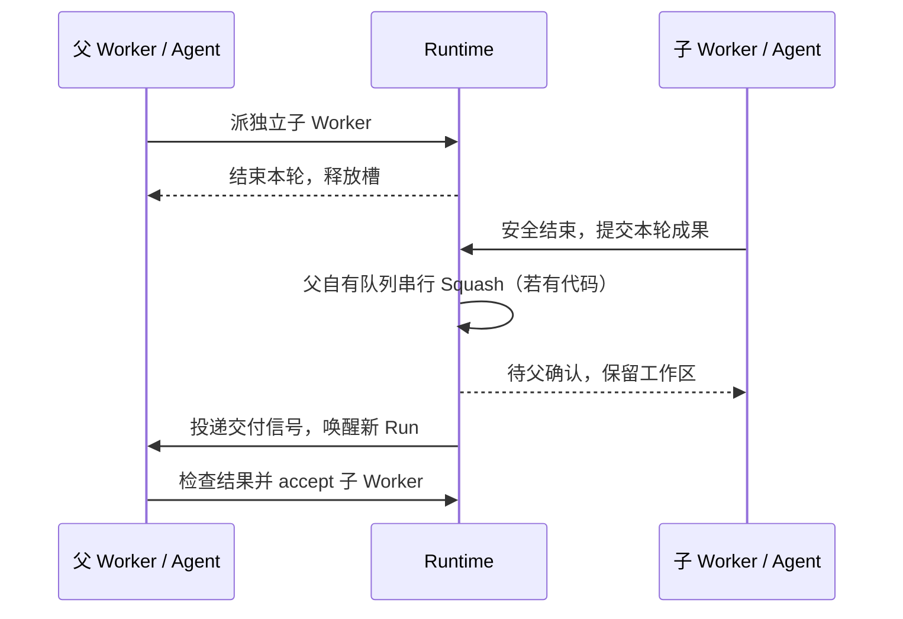

# 执行模型：Worker、Agent 与 Run

本章面向维护调度与 Agent 的开发者，说明当前指令路径的一次工作如何跨多轮调用继续。

> 连续阅读：[架构总览](../core-architecture.md) → **执行模型** → [交付与验收](review-loop.md) → [工程索引](architecture.md)

## 稳定身份与单次调用

Worker 持久保存目标、父子关系、状态、消息和工作区；Agent 与 Worker 一对一，但不是常驻进程。每次 provider invocation 都有独立的 `agent_runs` 记录、临时凭证和结果。等待子Worker或用户时 Worker 释放执行槽；下一轮继续使用同一 Worker/Agent 身份，但旧凭证不能复用。[一次 invocation](invocation.md)描述收件箱、恢复和安全抢占。

- 新指令输入直接拥有 `agent` Worker，不创建 planner/scheduler。父 Agent 可按需派子 Worker；新 child 默认开启锁定的自动合并 hook，安全点交给父 Worker 自有队列的 runtime 串行 Squash，不新建 merge Worker、不改父子关系、不额外调用父 Agent。无提交的干净 child 只交付结果、等父确认。
- 一轮正常返回后的指令 Worker 通常处于 `waiting`，保留分支与再次唤醒能力；`awaiting` 等用户答复；用户主动中断发送暂停意愿（`interrupt_state=requested`），当前调用在安全点收尾后才停在非终态 `paused`。继续立即接受：未认领则撤销，已触发则内部排队等待旧调用退出（`interrupt_state=resuming`），避免调用重叠。暂停请求期间也可追加消息或保存下一次调用的运行设置，不热改旧调用。终态 Worker 不允许活动后代。
- 新式 version 2 合并后进入非终态 `awaiting_acceptance`，不自动调用 Agent；追加输入继续原 Worker，指令由用户验收；child 经父 Agent 检查成果后默认保留供追加需求，尽量随父级安全批量验收才 completed，验收即安全归档回收。历史已合并Worker显式恢复与安全同步见[持续迭代](task-iteration.md)。
- 用户追加输入先持久化，再尝试在可证明的安全点收尾：当前 Pi 可在 `turn_end` 抢占，记录 `preempted` Run；无安全点后端只在自然轮末交付，不把硬杀冒充安全中断。
- 未知外部副作用的中断不自动重放。Run 结束、Worker 结算、代码集成互不等价。

## 单机执行与执行节点退役

W320／D684：Lush 的 Host、项目 daemon、Agent、代码工作区与命令统一在同一机器运行，不再提供执行节点、跨机工具、SSH 部署、节点授权或节点选择。浏览器仍可远程访问这台机器的 Host；这不属于分布式执行。

- 新建指令、派工与条件发射均使用本机工作区；公开入口拒绝已退役的 `runner_node_id` 参数，旧草稿中保存的选择不改写、也不再决定执行位置。
- 原节点配置、凭据、部署记录和项目附属历史原样保留，但不加载、不连接、不迁移，也不自动停止或卸载远端服务。
- 已有远端绑定只作历史识别，读面以 `execution_retired:true` 明示。保留输入、会话、执行记录及中央已接收的固定提交；远端现场不可读，不用中央提交冒充现场，不把旧路径交给本机工具。
- 旧远端 Worker 不再续跑、自动恢复或重放；涉及它的合并、父同步、验收、归档、回收及彻底删除必须拒绝，不把遗留远端资源标成已停止或已清理。无落地凭据的旧预约不占本机父执行位；保留父侧 Git 落地凭据，或执行中归并的关键记录缺失／归属不符时，仍阻止竞争写入并提示人工核查，不自动重放或清除历史。其余本机 Worker 正常运行。
- 不再注册 `runner.*` RPC、`lush runner` CLI 或执行节点管理 HTTP 入口；界面移除节点管理、部署、选择及恢复动作，只对遗留 Worker 提示退役状态。

## 统一检查协调器（第一阶段）

每个 Project 持有一个内部 `RuntimeCoordinator`（`src/core/runtime-coordinator.js`）。当前统一三个检查入口：`kick` 的 Agent 准入、`scheduleTaskHooks` 的 Hook 状态观察、`scheduleInputEmissions` 的条件输入发射。固定注册表在 Project 构造处维护，不新增公共 RPC、配置或持久业务实体。

协调器合并同类检查请求，保证同类单飞；执行中再次收到请求保留一次后续检查，不忙等、不丢唤醒。不同检查互不等待长异步任务；每批有界，并让出事件循环。检查失败只报告，不把条件仍满足当作重试副作用的授权。维护／冻结等业务准入仍由原模块复核；显式安全边界上的即时观察保持原顺序，不能把短暂安全窗口改成稍后才有机会检查。

协调器只保存可丢弃的内存唤醒，不保存授权、事件或成果。既有 SQLite 意图、事件身份、执行收据和各自的启动恢复仍为权威；当前没有新增兜底轮询。停止实例时立即拒绝新检查，取消尚未开始的检查，并在关闭 Store 前等待已开始的检查真正退出；维护／重启屏障计入在途检查。不同项目不共享协调器。

后续按阶段演进，以下尚未实现：

1. 将更多条件等待的发现／准入接入协调器，保留专用执行器、父队列公平性和逐事件语义。
2. 收敛启动恢复与有界兜底巡检；只推进已持久授权且确认未开始的工作，不补跑应跳过的定时发生，不重放 failed／unknown 副作用。
3. 在覆盖迁移调用点后清理旧调度胶水；用户 Hook 配置与内置生命周期推进分层，不机械删除历史字段或安全协议。

## 历史数据边界

旧 version 1 人工确认语义不改，旧 version 2 merge 身份与在途重挂只按明确预约／审计兼容恢复；完整协议见[分支合并](merge.md)。旧 Intent / Plan / Candidate 与 planner / scheduler 的记录、会话与工作区保留在磁盘上，不迁移、不删除，但不再有公开入口，也不会自动启动或重放。control / execution 两条容量车道仍是运行时的准入机制，普通指令不调用规划模型。当前可调用面见[核心 API 收敛](core-api.md)。

---

[← 上一篇：架构总览](../core-architecture.md) · [下一篇：交付与验收 →](review-loop.md)
