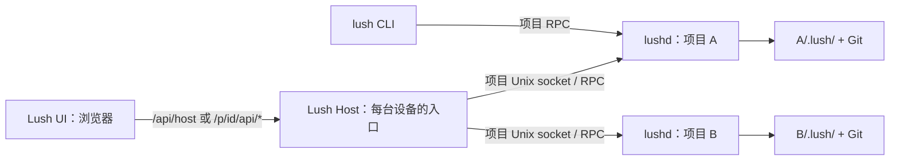

# Lush 三层边界

启动与环境管理遵循[工作台设计](../design/workbench.md)和[接入契约](workbench.md)：主体先于项目启动，每个项目独立浏览器标签，远程网络由用户配置。无项目/离线状态不阻塞管理、界面设置与文档；关闭页面或用户自建隧道 不停止任务。

- **UI**（`src/ui/web/assets/`）：不读取本机 socket、项目数据库或 Git。项目操作必须使用当前页面 `/p/<id>/` 的身份；宿主级列表和文档不带项目身份。
- **Host**（`bin/lush-host`、`src/host/`、HTTP 适配器 `src/ui/web/server.js`）：处理浏览器认证、项目登记、路由、连接缓存和有界状态读取。`GET /api/host/projects` 只检查已登记目录对应的 socket，不启动 daemon；显式选择/启动项目时才按需启动；项目 API 附着不会启动 daemon，避免旧标签页轮询撤销停止操作。`launcher.json` 是界面缓存，不是Worker数据库。浏览器直接访问目标 Host，关闭页面不停止任何项目 lushd。服务器 Host 与 SSH/转发/IP/域名由用户自行配置，见[远程 Host 部署](../deployment/remote-host.md)。
- **lushd**（`bin/lushd`、`src/daemon/`、`src/core/`、`src/persistence/`、`src/rpc/`）：一项目一进程，绑定 canonical 路径，事实仅在 `<project>/.lush/`，执行 Agent 与项目内调度。Host 不复制事实、不做跨项目调度。UI 当前通过有界轮询读取项目消息与状态，Host 只把响应转交相应页面；尚无后台推送通道。CLI `lush` 也可直接通过项目 socket 访问 lushd。

W363／D738 的[项目管家密码提权](administrator-valet.md)由当前项目原生 management Worker 执行：Host 重新验证当前 Web 登录密码，签发精确项目／内容绑定 proof；授权、调用、审计和真实执行 owner 仍归来源项目 daemon，Host 不持有 Worker。权限仅本条、仅当前项目，下一条默认普通；旧设备级 ADM 不再接受创建／输入／执行，历史和安全停止保留。

对外入口：`bun run lush host start|stop|restart|status`，`bun run lush-host`（前台），以及项目端 `bun run lush daemon start|restart|stop`（源码业务快捷包装已删除）。原 `web*` 命令、`bin/lush-web`、`/api/launcher*` 已移除；原有 `launcher.json` 和 `web.json` 留在原用户配置目录，不迁移或清除项目数据。运行中的旧 Host 不会自动换代码：确认没有需要保留的登录会话后重启 Host；项目代码变化还需分别重启相应 lushd。
